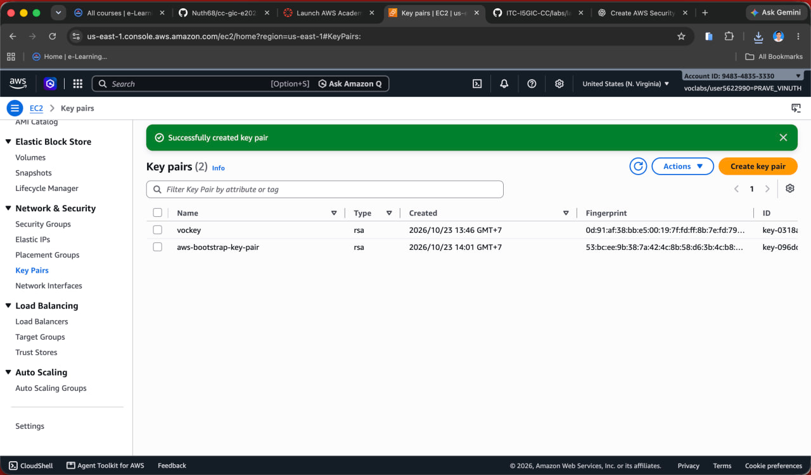
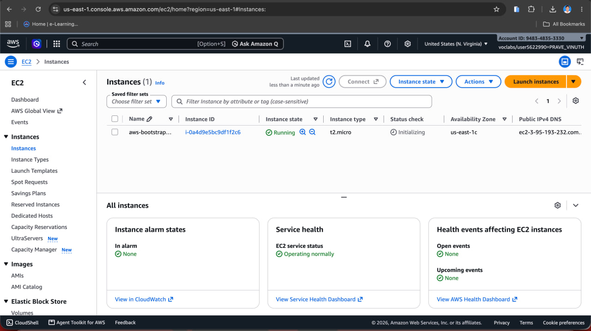
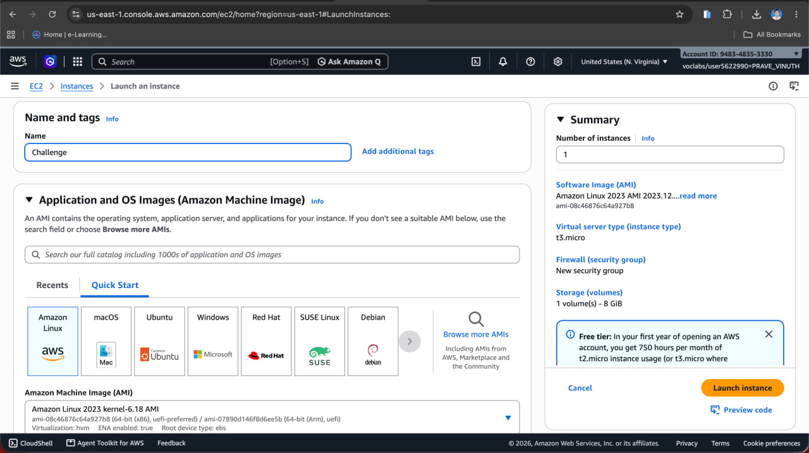
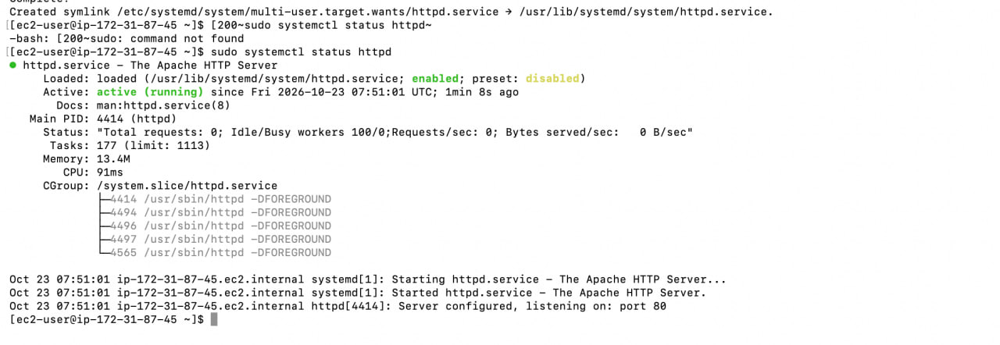

# Cloud Lab 1 Submission — Amazon EC2

Copy this template to `cc-lab-YOUR_ID/lab1/README.md` in your own repository. Follow [the instructions](lab1-instruction.md). Put your screenshots in `lab1/images/` with the file names below.

- **Student name: PRAVE  Vinuth**
- **Student ID: e20220507**
- **Learner Lab user name: voclabs/user5622990=PRAVE_VINUTH**
- **Date completed: Fri 23 Oct**

---

## Part 1.1 — An Amazon EC2 Walkthrough

### Security group


### Key pair



### Instance details



### Browser test


### SSH connection


Did you connect with your own SSH client or with EC2 Instance Connect?

---

## Part 1.2 — EC2 Web Solution (Challenge)

### Launch configuration



### Security group


### Running instance


### Commands on the instance




Paste the commands you ran to install the web server and create `index.html`:

```bash
sudo yum update -y
sudo yum install -y httpd
sudo systemctl start httpd
sudo systemctl enable httpd
sudo systemctl status httpd

```

### Browser test


---

## Questions

1. Your security group has an SSH rule and an HTTP rule. What does each one let you do? What would stop working if you deleted the HTTP rule?
2. In Part 1.1 you never logged in to install the web server. What installed it, and when did it run?
3. Why does the web page open with `http://` but not with `https://`?
4. Part 1.2 asked for a 10 GiB root volume. Where in the launch settings did you set it, and how can you check the size on the running instance?

## Problems and how I solved them (optional)

## AI note (optional)

One suggestion an AI tool gave you and how you checked it.

## Clean up

- [ ] Part 1.1: instance terminated, key pair and security group deleted.
- [ ] Part 1.2: instance terminated, security group (and key pair, if any) deleted.