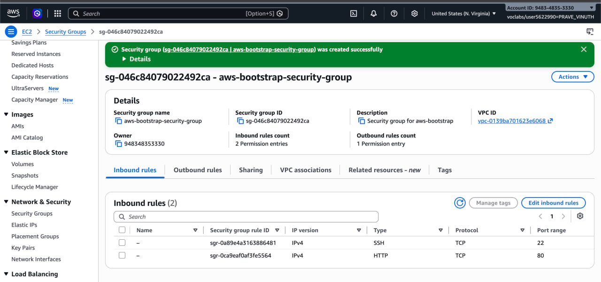
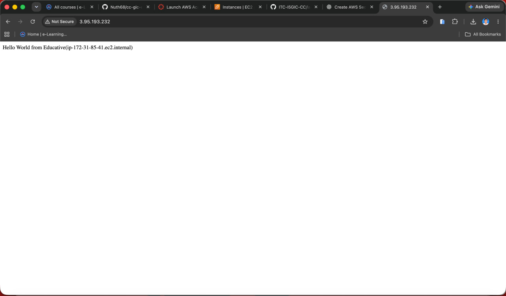
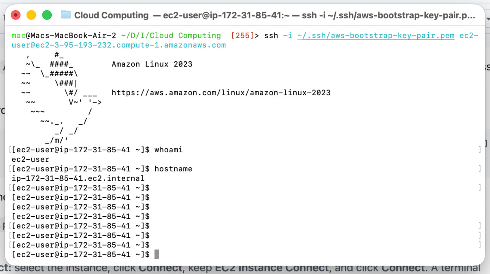
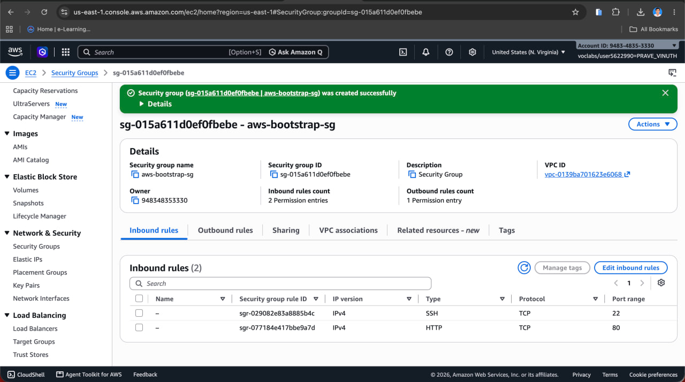
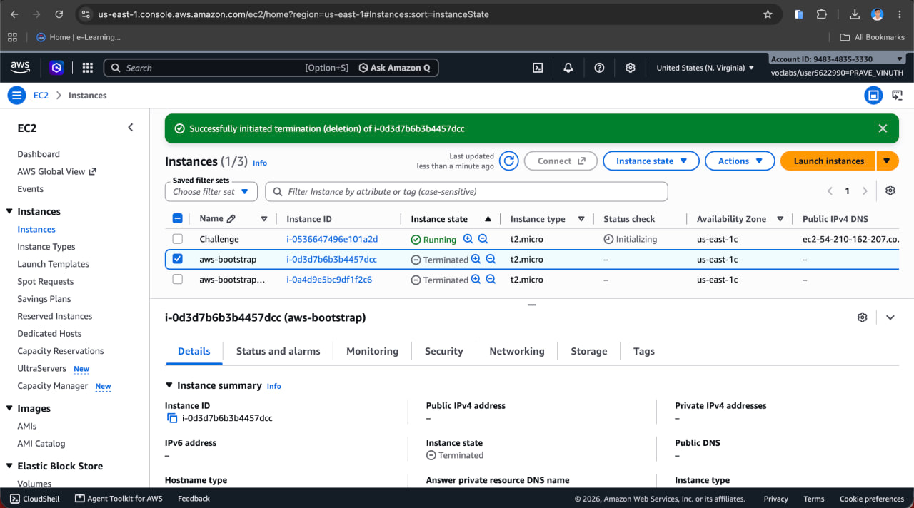
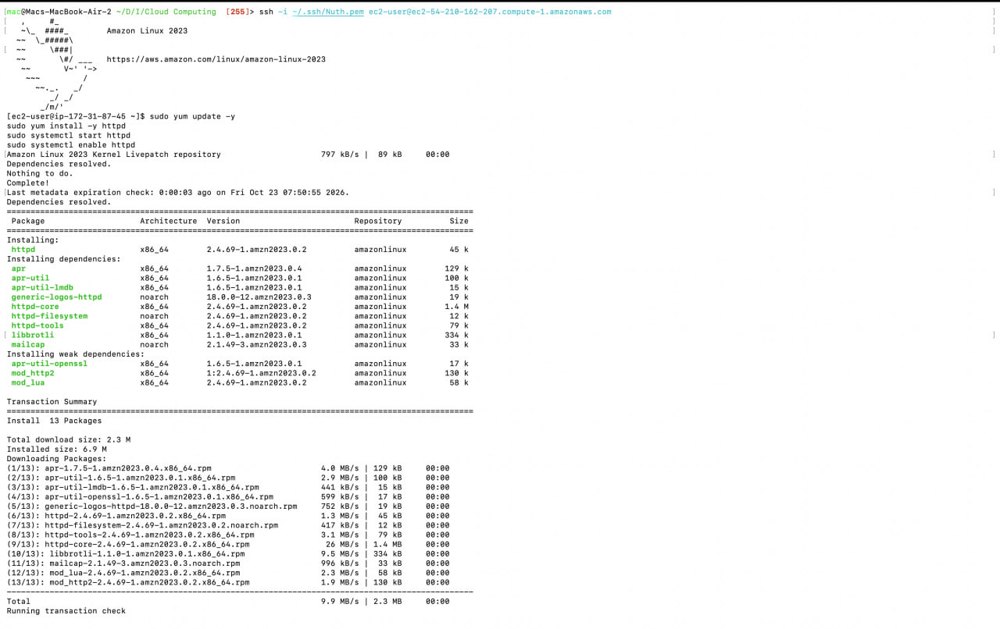
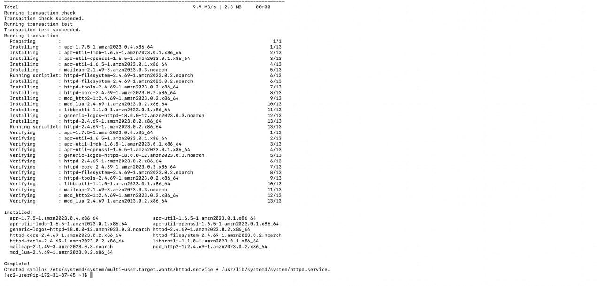
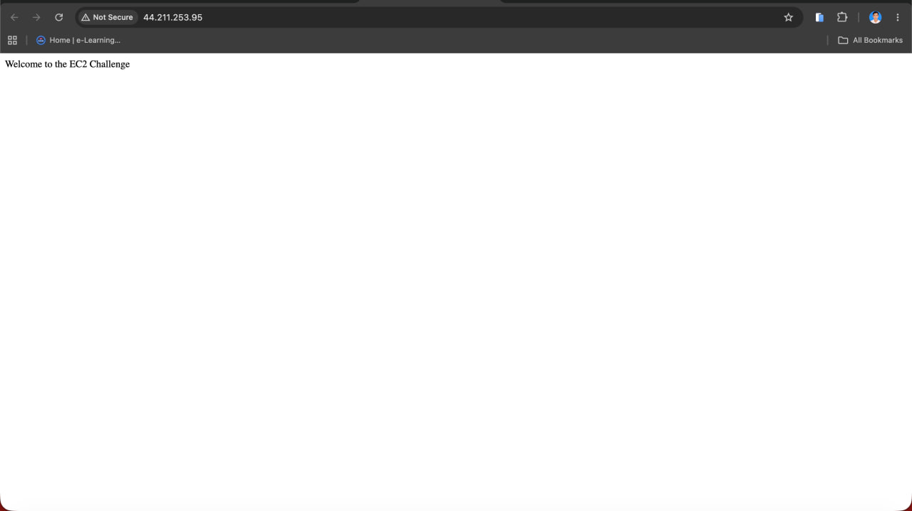

# Cloud Lab 1 Submission — Amazon EC2


- **Student name: PRAVE  Vinuth**
- **Student ID: e20220507**
- **Learner Lab user name: voclabs/user5622990=PRAVE_VINUTH**
- **Date completed: Sat 24 Oct**

---

## Part 1.1 — An Amazon EC2 Walkthrough

### Security group



### Key pair


### Instance details


### Browser test



### SSH connection



Did you connect with your own SSH client or with EC2 Instance Connect?

---

## Part 1.2 — EC2 Web Solution (Challenge)

### Launch configuration


### Security group



### Running instance



### Commands on the instance





Paste the commands you ran to install the web server and create `index.html`:

```bash
sudo yum update -y
sudo yum install -y httpd
sudo systemctl start httpd
sudo systemctl enable httpd
sudo systemctl status httpd
echo '<!DOCTYPE html>
<html>
<head>
    <title>EC2 Challenge</title>
</head>
<body>
    <h1>Welcome to the EC2 Challenge</h1>
</body>
</html>' | sudo tee /var/www/html/index.html

```

### Browser test



---

Clean up
 - [✓]Part 1.1: instance terminated, key pair and security group deleted.
 - [✓]Part 1.2: instance terminated, security group (and key pair, if any) deleted.