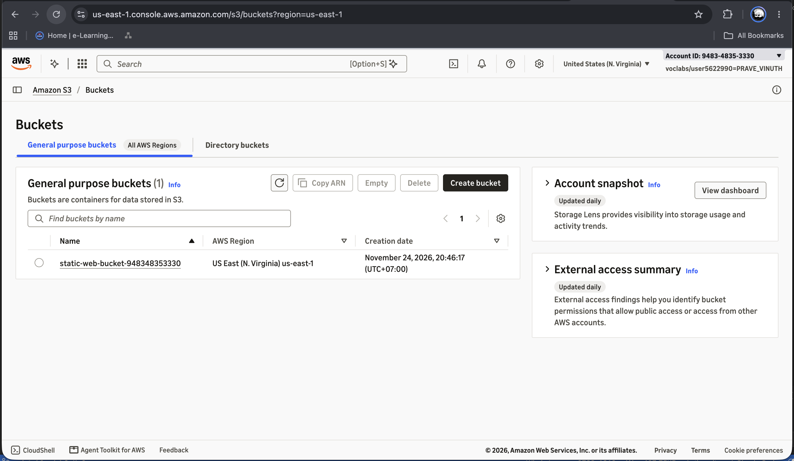
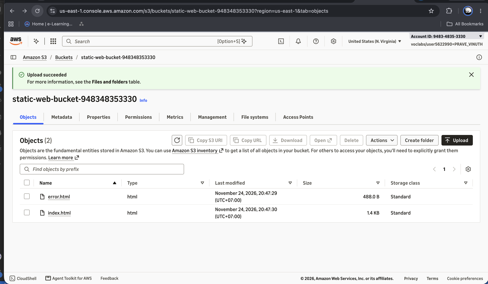
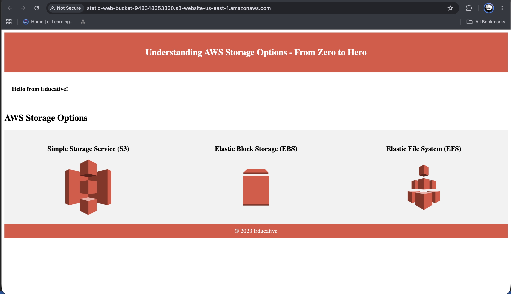
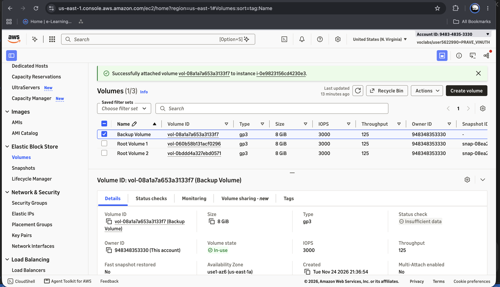
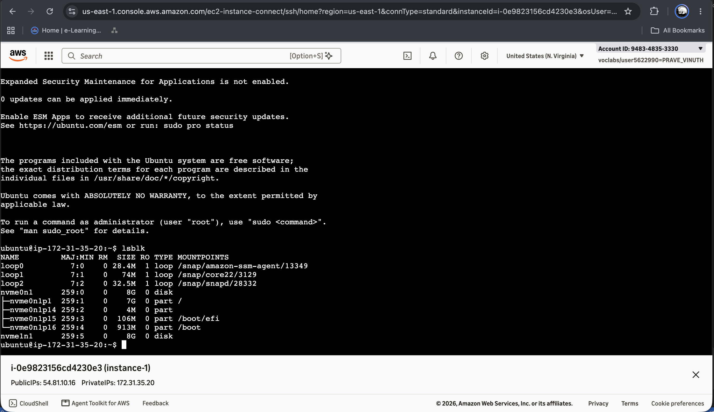
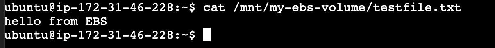
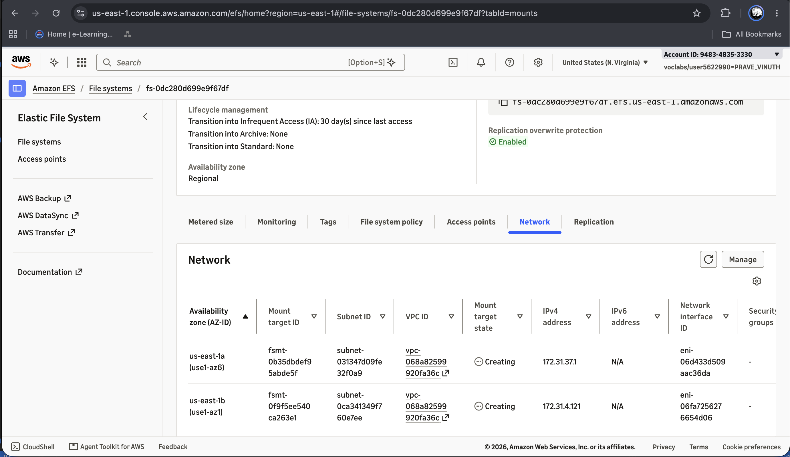
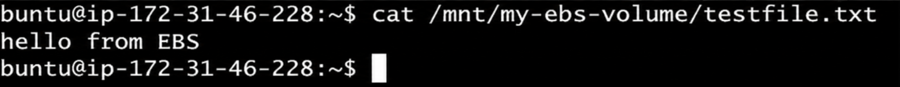
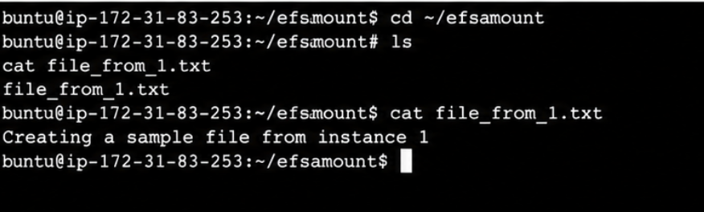

# Cloud Lab 3 Submission — AWS Storage Options

Copy this template to `cc-lab-YOUR_ID/lab3/README.md` in your own repository. Follow [the instructions](lab3-instruction.md). Put your screenshots in `lab3/images/` with the file names below.

- **Student name:** Prave Vinuth
- **Student ID:** e20220507
- **Learner Lab user name:** voclabs/user5622990=PRAVE_VINUTH
- **Date completed:** 28 November 2026

---

## Part 2.1 — Amazon S3

### Bucket list

### Uploaded files

### Static website

---

## Part 2.2 — Amazon EBS

### Volumes page

### Attached volume (`lsblk`)

Which device name did your volume get (`xvdf`, `nvme1n1`, ...)?

### File read on instance-2

---

## Part 2.3 — Amazon EFS

### File system and mount targets

### File created on instance-1

### File listed on instance-3

---

## Questions

1. The endpoint returned **403 Forbidden** because the objects in the S3 bucket were private and the website endpoint did not have permission to read them. The bucket policy granted public `s3:GetObject` permission, so visitors could retrieve and view the website files.

2. `testfile.txt` remained available because it was stored on the separate **Backup Volume**, which continued to exist after it was detached from `instance-1` and attached to `instance-2`. A file on `instance-1`'s root volume would normally have been deleted when the instance was terminated because an EC2 root EBS volume is usually configured with **Delete on termination** enabled.

3. I ran `mkfs` on `instance-1` because the new **Backup Volume** was blank and needed a file system before it could be mounted. I did not run it again on `instance-2` because the volume already contained the file system and `testfile.txt`. Running `mkfs` again could have erased the existing data.

4. EFS is a managed network file system designed to be mounted by multiple instances at the same time. An EBS volume is block storage and, in this lab, could be attached to only one instance at a time, so it had to be detached before being moved. EFS mount targets provide network endpoints in the VPC; the instances needed network connectivity to a mount target, with routing and security-group access to NFS port `2049`. A mount target in each instance's Availability Zone provides local and reliable access; the instances do not strictly have to be in the exact same subnet if the VPC routing allows access.

5. **(a) S3** is suitable for a website's images because it provides durable, scalable object storage for static files. **(b) EBS** is suitable for a database server's disk because it provides low-latency block storage that behaves like an attached disk. **(c) EFS** is suitable for a folder shared by several web servers because multiple instances can mount and use the same file system concurrently.

## Problems and how I solved them (optional)

- The S3 website initially returned **403 Forbidden**. I added a bucket policy that allowed public read access to the website objects and then tested the endpoint again.
- When moving the EBS volume, I used `lsblk` to identify the device and made sure it was unmounted and detached from `instance-1` before attaching and mounting it on `instance-2`.
- For EFS access, I allowed NFS traffic on port `2049` between the EC2 and EFS security groups and used the mount target information to mount the file system.

## AI note (optional)

An AI tool suggested checking whether the EBS volume already had a file system before running `mkfs`. I checked the device with `lsblk -f` and confirmed that the file system created on `instance-1` was still present on `instance-2`. I mounted it without formatting it again and verified that `testfile.txt` was available.

## Clean up

- [✓] Instances `instance-1`, `instance-2`, `instance-3` terminated.
- [✓] `clab-efs` and **Backup Volume** deleted.
- [✓] Security groups `efs-sg` and `ec2instances-sg` deleted.
- [✓] S3 bucket emptied and deleted.
