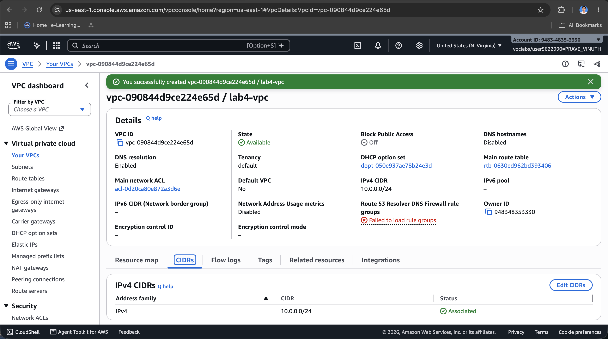
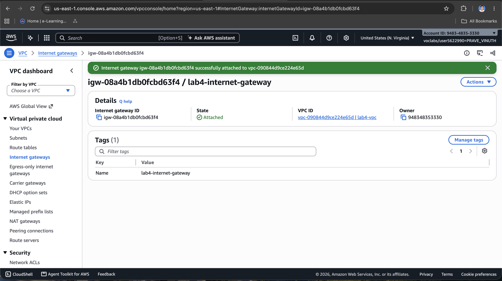
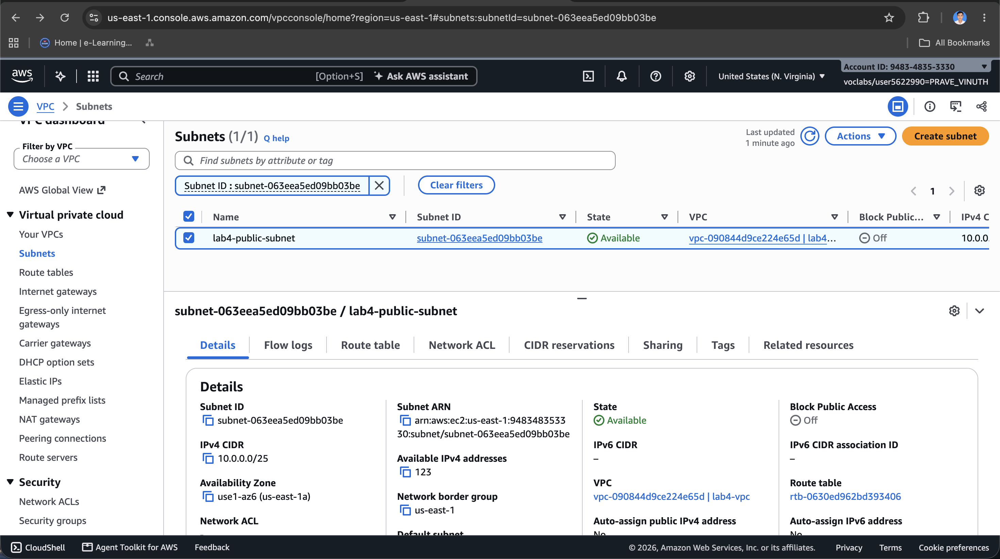
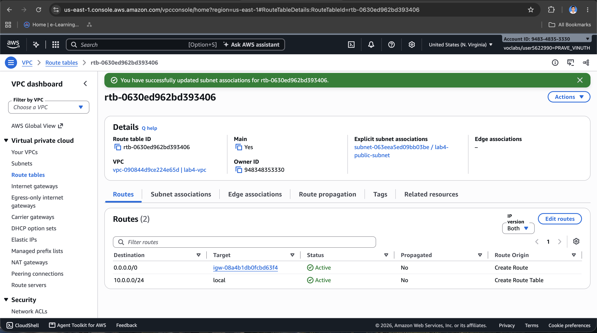
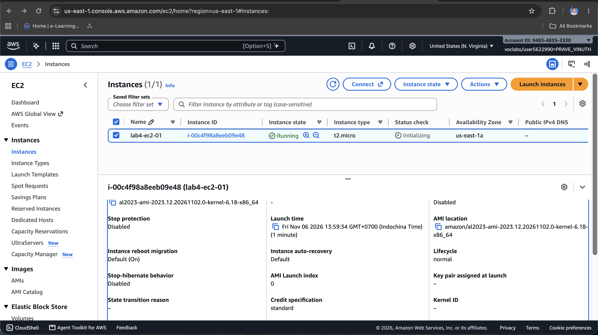
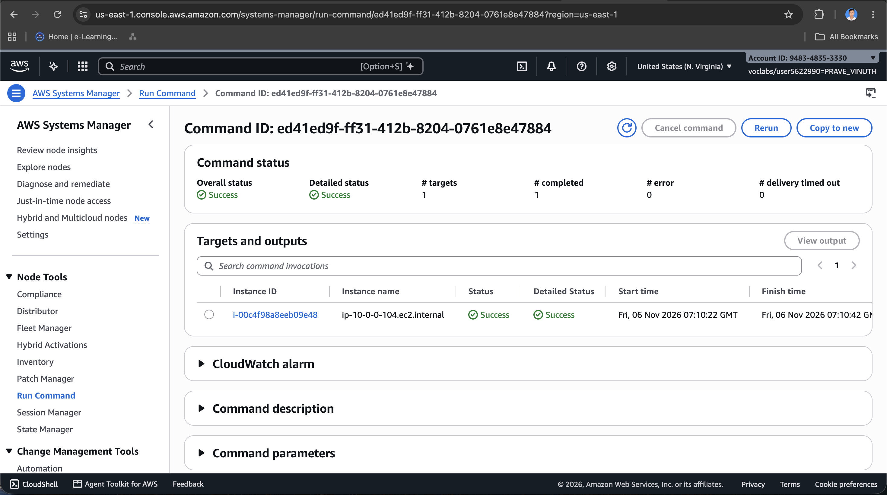
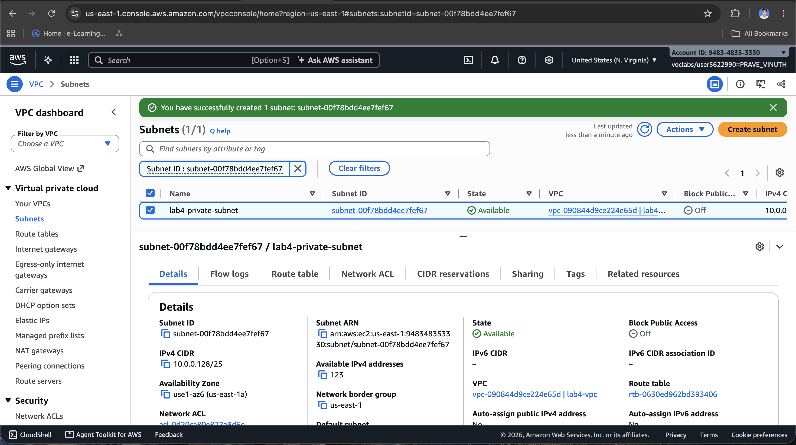
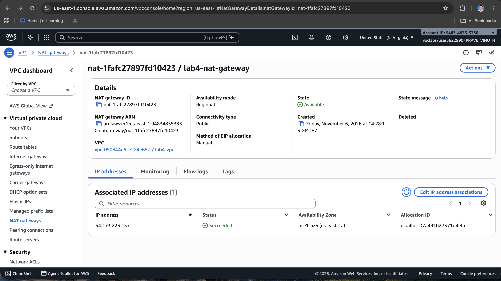
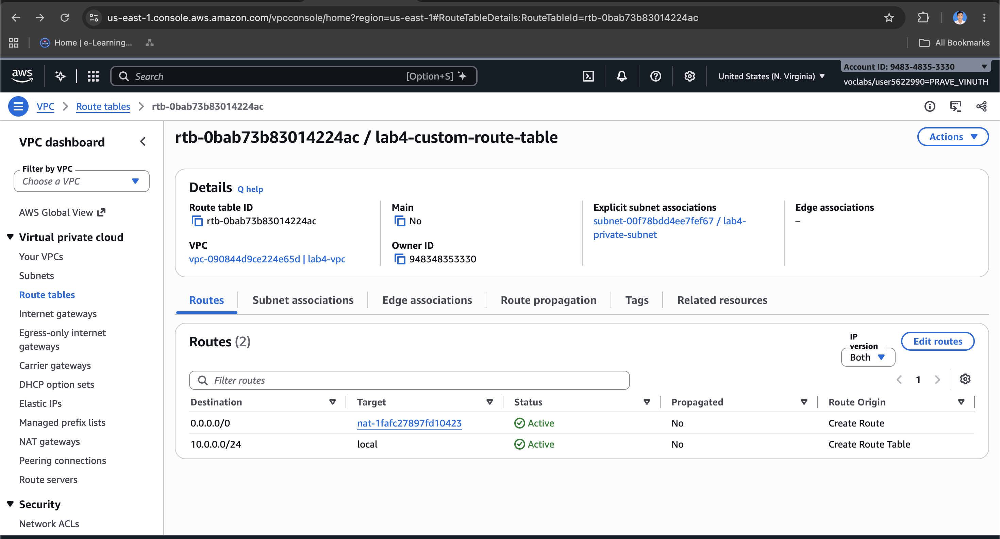
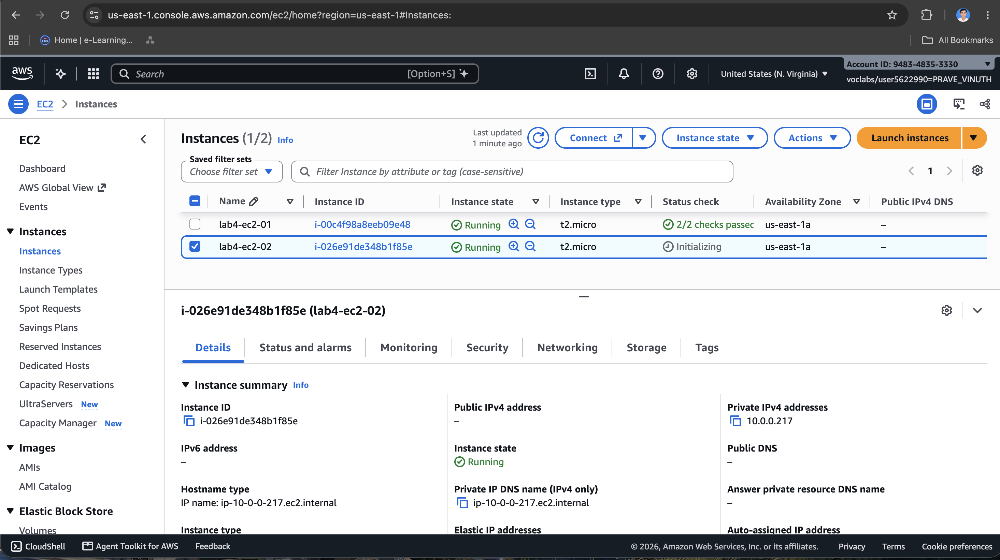

# Cloud Lab 4 Submission — Amazon VPC

- **Student name:Prave Vinuth** 
- **Student ID:e202220507** 
- **Learner Lab user name:voclabs/user5622990=PRAVE_VINUTH**
- **Date completed:Fri 6 Noverber**

---

## VPC and internet gateway

## Public subnet

## Private subnet

---

# Lab 4 Questions and Answers

## 1. VPC and subnet IP addresses

- The VPC `10.0.0.0/24` contains **256 IP addresses** (`10.0.0.0` to `10.0.0.255`).
- The subnet `10.0.0.0/25` contains **128 IP addresses** (`10.0.0.0` to `10.0.0.127`).
- The subnet `10.0.0.128/25` also contains **128 IP addresses** (`10.0.0.128` to `10.0.0.255`).

They do not overlap because the first subnet ends at `10.0.0.127`, while the second one starts at `10.0.0.128`.

> AWS reserves five IP addresses in each subnet, so each `/25` subnet has 123 addresses available for resources.

## 2. What makes the subnets public or private?

`lab4-public-subnet` is public because its route table has a default route (`0.0.0.0/0`) to an **Internet Gateway**. A resource also needs a public IP address to communicate directly with the internet.

`lab4-private-subnet` is private because it has no direct route to the Internet Gateway. Its default route points to the **NAT gateway**, which allows outbound internet access without allowing direct inbound internet connections.

## 3. Why is the NAT gateway in the public subnet?

The NAT gateway needs a public IP address and a route to the Internet Gateway. The public subnet provides this connection. Resources in the private subnet send their internet traffic to the NAT gateway, and the NAT gateway forwards it to the internet.

If the NAT gateway were placed in the private subnet, it would not have a direct path to the Internet Gateway and could not provide internet access.

## 4. Internet access for `lab4-ec2-02`

Someone on the internet **cannot start a direct connection** to `lab4-ec2-02` because it has no public IP address, and the NAT gateway does not accept new inbound connections for it.

The instance **can download updates**. It sends the request through the private subnet's route to the NAT gateway. The NAT gateway then sends the request to the internet through the Internet Gateway and returns the response to the instance.

## 5. Why was `LabInstanceProfile` needed for Systems Manager?

Systems Manager must verify that an EC2 instance has permission to connect and receive commands. `LabInstanceProfile` gives the instance the required IAM permissions without storing access keys on it.

The SSM Agent running on the instance uses these permissions to register with Systems Manager and create a Session Manager connection, so SSH and an open SSH port are not required.

## Problems and how I solved them (optional)

## AI note (optional)

One suggestion an AI tool gave you and how you checked it.

## Clean up

- [✓] Instances terminated.
- [✓] NAT gateway deleted and its Elastic IP released.
- [✓] Internet gateway detached and deleted.
- [✓] `lab4-vpc` deleted.